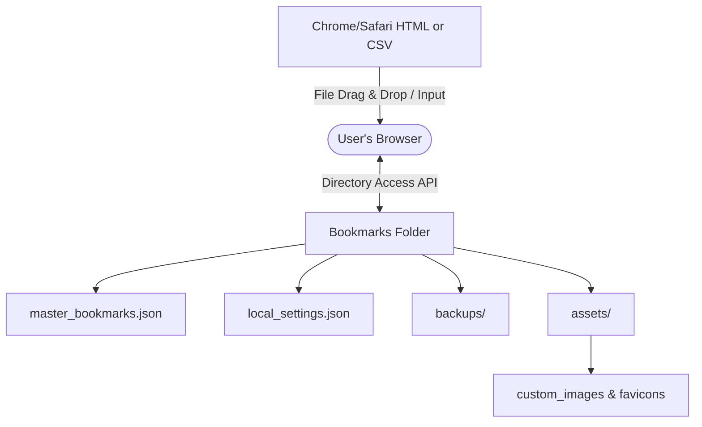

# Plan: Serverless, Local-First Bookmark & Link Manager

This plan outlines the architecture, data schemas, implementation steps, and specific developer prompts to build a bookmark manager that runs **100% in the browser** by opening a single HTML file directly (`file:///.../index.html`), with no local web server or background database processes required.

---

## 1. Architecture Overview

To achieve direct file persistence, asset storage, and absolute local control without running a local web server, the application is designed around the **Directory Access API**.



### Key Architectural Decisions
1. **Directory Access API**: The browser requests permission to access a local folder (e.g., `bookmarks-data/`).
   * **Structured Files**: Manages `master_bookmarks.json`, `local_settings.json`, and dated snapshots in a `/backups/` sub-directory.
   * **Local Image & Asset Storage**: Custom icons or images are saved into an `/assets/` subdirectory. When displaying cards, the app reads these images from the disk and converts them to temporary Object URLs (`URL.createObjectURL`).
2. **Universal Link Support**: Because the application runs under the browser's native local file protocol (`file:///.../index.html`), it has fewer security restrictions compared to sandboxed web servers. It can natively launch:
   * **Web Pages**: `https://...`, `http://...`
   * **Local Files & Folders**: `file:///C:/path/to/document.pdf` or `file:///Users/username/Projects` (supported because the host page is on the `file://` protocol).
   * **App Deep Links**: Custom schemes like `vscode://`, `obsidian://`, `spotify://`, `zoommtg://`, `slack://`, etc.
3. **No Auth & Zero-Installation**: Runs entirely on the local device, requiring no login or installation.

---

## 2. File Formats & Storage (Directory Approach)

### A. Master Config File (`master_bookmarks.json`)
The file contains rich bookmark metadata including custom colors, icon types, and custom protocols:

```json
{
  "version": 1,
  "categories": [
    {
      "id": "cat-dev-tools",
      "name": "Dev Tools",
      "icon": "Code",
      "color": "#6366f1",
      "bookmarks": [
        {
          "id": "link-github",
          "title": "GitHub",
          "url": "https://github.com",
          "description": "Code hosting",
          "tags": ["git", "dev"],
          "clicks": 42,
          "customStyle": {
            "cardColor": "#1e1e2e",
            "borderColor": "#89b4fa"
          },
          "icon": {
            "type": "lucide",
            "value": "Github"
          }
        },
        {
          "id": "link-local-project",
          "title": "Project Folder",
          "url": "file:///Users/username/Projects/Dashboard",
          "description": "Local workspace folder",
          "tags": ["local", "work"],
          "clicks": 15,
          "customStyle": {
            "cardColor": "#181825",
            "borderColor": "#a6e3a1"
          },
          "icon": {
            "type": "local-image",
            "value": "project-thumb.png"
          }
        }
      ]
    }
  ]
}
```

### B. Machine Settings File (`local_settings.json`)
Saves the specific layout overrides for this browser instance:

```json
{
  "theme": "glass-dark",
  "layout": {
    "gridColumns": 4,
    "categoryOrder": ["cat-dev-tools"],
    "hiddenCategories": []
  },
  "groups": [],
  "cardPositions": {}
}
```

---

## 3. Potential Enhancements & Future Features
Future ideas and enhancements are tracked in the `Ideas and Enhancements.md` file.
